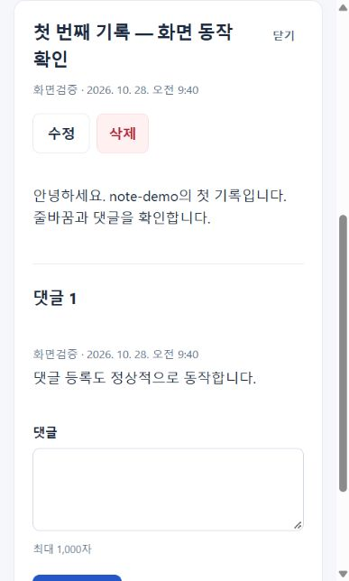

# 구현·검증 기록

검증일: **2026-10-28 (Asia/Seoul)**

## 실행 환경

- Windows PowerShell, Python 3.12.14, 프로젝트 `.venv`.
- Flask 3.1.3, Flask-WTF 1.3.0, Werkzeug 3.1.9, python-dotenv 1.2.4, pytest 9.1.1.
- 의존성은 실제 가상환경에 설치했으며 실행용 버전은 `requirements.txt`에 고정했다.

## 수행 결과

| 검증 | 실제 결과 |
| --- | --- |
| `.venv\Scripts\python.exe -m pytest -q` | **59 passed in 21.55s** |
| `.venv\Scripts\python.exe -m pip check` | `No broken requirements found.` |
| `node --check app/static/app.js` | 종료 코드 0, 문법 오류 없음. Node는 개발 검증에만 사용하며 앱 실행·배포에는 필요 없음 |
| `python -m compileall -q app scripts tests wsgi.py` | 종료 코드 0 |
| `scripts/configure.py` → `init-db` → `import-rules` | 로컬 설정·새 DB 생성, 규칙 5개 반입 성공 |
| 로컬 HTTP 확인 | `/` HTTP 200, HTML 3,390 bytes |
| 실제 브라우저 | 초기 빈 목록 → 회원가입 → 로그인 → 글 작성 → 같은 페이지 상세 → 댓글 등록 → 새로고침 후 로그인·데이터 유지 확인 |
| 좁은 브라우저 화면 | 글·댓글·폼 배치 확인. 닫기 버튼 줄바꿈을 발견해 버튼 줄바꿈 방지·축소 방지로 수정 |
| 원본 설계안 | prompt.md 원문을 수정하지 않았고 기존 SHA-256 값과 일치 |

자동 테스트에는 이메일·비밀번호 검증, 개인별 해시 저장, 역할·작성자 주입 거부, 쿠키 위조·만료·재사용 차단, 재시작·로그아웃·새 로그인, CSRF 누락·위조, 계정별 권한, 0·1·10·11·21개 페이징, 마지막 페이지 보정, 댓글 격리·CASCADE, 긴 표현·겹침·특수문자 마스킹, 관리자 규칙 갱신, CLI 중복 실행 보호·백업·파일 검증, WSGI 부작용 차단, 배포 쿠키, 비공개 파일 경로와 배포 ZIP 제외 정책을 포함했다.

테스트는 임시 DB를 사용했다. 실제 브라우저 확인에는 로컬의 합성 계정과 합성 게시글·댓글만 사용했으며 실제 개인정보·공개 관리자 자격증명은 만들지 않았다. 이 시연 데이터는 로컬 DB에만 있고 소스 ZIP에 포함되지 않는다.

## 배포 상태와 한계

- PythonAnywhere 계정 접속·업로드·Web 앱 생성·실제 URL 확인은 수행하지 않았다. 배포 가이드는 오늘 확인한 공식 문서를 기준으로 작성했다.
- SQLite는 저트래픽 데모용이다. 부하·대량 동시 쓰기·장시간 운영 시험은 수행하지 않았다.
- 이메일 소유 확인·실제 비밀번호 재설정은 제공하지 않는다. 비밀번호 찾기는 목업이며 관리자 생성은 명시적 콘솔 명령이다.
- 키워드 필터는 문맥을 이해하지 못한다. 초기 규칙은 [선정·출처 설명](masking-sources.md)에 기록한 제한적인 목록이며 새 표현·우회 표현을 모두 탐지하지 않는다.

배포 후에는 [README의 배포 후 확인](../README.md#5-6-배포-후-확인)을 실제 계정과 도메인에서 수행해야 한다. 로컬 테스트 통과를 실제 배포 완료로 간주하지 않는다.

