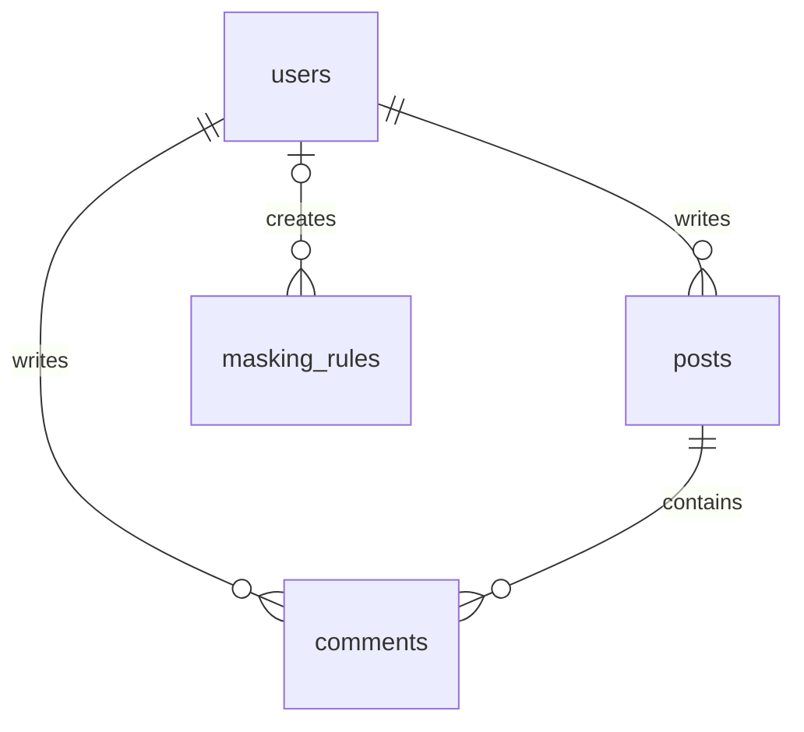

# note-demo 구현 계획

- 상태: **최종본 v1.0 — PythonAnywhere 무료 배포 피드백 반영**
- 정리일: 2026-10-27 (Asia/Seoul)
- 기준: `prompt.md`, `agent-prompt.md`, `database-schema.sql`
- 반영한 사용자 피드백: “PythonAnywhere 무료 사이트로 배포할 예정이므로 맞지 않는 설계를 수정·제거”
- 구현 갱신: 2026-10-28. 사용자 승인 후 애플리케이션·CLI·화면 구현과 로컬 테스트 59개를 완료했다. 실제 PythonAnywhere 배포는 수행하지 않았으며, 현재 실행·배포 방법과 검증 결과는 README.md와 docs/verification.md를 기준으로 확인한다.

## 1. 구현 목표와 배포 전제

PythonAnywhere 무료 계정의 **일반 WSGI Web 앱 하나**에 배포하는 소규모 게시판을 만든다. 구성은 **Flask + SQLite + HTML/CSS/순수 JavaScript**로 정한다. 화면과 JSON API는 같은 도메인을 사용한다.

회원가입·로그인·로그아웃, 제목·본문 게시글, 페이지당 10개 목록, 같은 화면의 상세·댓글, 본인 글 수정·삭제, 관리자 마스킹 규칙 추가·삭제를 구현한다. 비밀번호 찾기는 실제 이메일을 보내지 않는 목업으로 유지한다.

회원별 비밀번호 해시와 서버 권한 검사는 공개 배포를 위한 현재 구현 범위에 포함한다. 원본에서 향후로 미뤘던 비밀번호 처리는 사용자의 배포 피드백에 맞춰 변경하며, 이메일 소유 확인·SNS 로그인·실제 비밀번호 재설정은 향후 범위로 남긴다.

## 2. 무료 환경 확인 결과와 설계 변경

공식 문서 확인일은 2026-10-27이다. 실제 배포 때 계정의 지역·생성 시기·제공 Python 버전을 확인한다.

| 확인한 환경 | 이번 설계에 적용할 내용 | 근거 |
| --- | --- | --- |
| 무료 계정: 웹 앱 1개, 워커 1개, 디스크 512 MiB, 웹 앱 만료 1개월 | 서버·화면 통합, 의존성·데이터·백업 최소화, Web 탭의 만료일·연장 확인 절차 기록 | [무료 계정 기능](https://help.pythonanywhere.com/pages/FreeAccountsFeatures/) |
| ASGI 배포는 실험 기능이며 정적 파일 매핑·관리 UI 등의 제약이 안내됨 | ASGI 베타를 필수로 삼지 않고 일반 Web 탭의 Flask WSGI 경로 선택 | [ASGI 베타](https://help.pythonanywhere.com/pages/ASGICommandLine/), [Flask 설정](https://help.pythonanywhere.com/pages/Flask/) |
| SQLite는 사용 가능하나 클라우드 파일 시스템에서 고부하 운영 DB로 권장되지 않음 | 저트래픽 데모, 짧은 트랜잭션, 요청별 연결, 인덱스와 10개 페이징 유지 | [DB 종류](https://help.pythonanywhere.com/pages/KindsOfDatabases) |
| 새 무료 계정은 MySQL·예약 작업을 전제로 할 수 없음 | SQLite 유지, 예약 작업·Redis·Celery·상주 작업 의존 제거 | [무료 계정 기능](https://help.pythonanywhere.com/pages/FreeAccountsFeatures/) |
| 무료 계정의 외부 통신은 허용 목록으로 제한됨 | 표현 목록 조사는 개발 환경에서 수행하고 결과 파일 포함, 서버 실행 중 외부 통신 불필요 | [허용 목록 정책](https://help.pythonanywhere.com/pages/RequestingAllowlistAdditions) |
| Web 앱은 WSGI 설정으로 실행 | 배포 중 개발 서버를 직접 띄우지 않고 WSGI의 application 사용 | [Flask 배포](https://help.pythonanywhere.com/pages/Flask/) |

### 기존 초안에서 수정·제거한 내용

| 기존 초안 | 이번 최종 계획 |
| --- | --- |
| FastAPI + Uvicorn, ASGI 서버 실행 | Flask + PythonAnywhere 관리 WSGI |
| 공개된 공통 데모 비밀번호, NULL 해시 | 개인별 Werkzeug 비밀번호 해시, NOT NULL |
| 메모리 세션 딕셔너리, 재시작 시 로그인 소실 | Flask 서명 쿠키 + DB auth_version + 지속되는 비밀키 |
| 로컬 주소와 포트 실행만 제시 | 로컬 실행과 Web 탭 배포 절차를 구분 |
| 최초 요청·앱 시작에서 초기화할 여지가 있는 구조 | 명시적 init-db / import-rules / create-admin 콘솔 명령 |
| 공개 또는 자동 시드되는 관리자 계정 | 비공개 비밀번호를 입력하는 관리자 생성 명령 |
| 배포 범위 제외 | PythonAnywhere 설정·배포 확인을 완료 기준에 포함 |

외부 검색 자동화, 실시간 LLM 필터, WebSocket, 무거운 프런트엔드 빌드, 별도 Node.js 서버, 컨테이너·직접 웹서버 설치는 구성에 넣지 않는다. FastAPI가 PythonAnywhere에서 전혀 불가능하다는 뜻은 아니며, 이 프로젝트에는 일반 WSGI 배포를 선택한 것이다.

## 3. 기술 구성과 예정 파일

| 구분 | 구성 |
| --- | --- |
| 서버 | Python + Flask, create_app() 팩토리 |
| DB | SQLite, 표준 sqlite3, 기존 4개 테이블 |
| 비밀번호 | Werkzeug generate_password_hash / check_password_hash |
| 로그인 | Flask 서명 세션 + users.auth_version 검증 |
| CSRF | Flask-WTF CSRFProtect, JSON 요청은 X-CSRFToken 헤더 |
| 설정 | python-dotenv로 프로젝트의 비공개 .env 로드 |
| 화면 | HTML/CSS/순수 JavaScript, 외부 CDN·웹폰트 의존 없음 |
| 테스트 | pytest + Flask test_client, 임시 DB |

로컬은 Python 3.12.14에서 구현·검증했고 Flask 3.1.3 등 실제 설치 버전을 requirements.txt에 기록했다. PythonAnywhere에서는 실제 Web 앱·가상환경에 공통 제공되는 Python 버전을 일치시킨다. 배포 실행은 README.md의 절차를 따른다.

```text
note-demo/
├─ prompt.md / agent-prompt.md / plan.md
├─ database-schema.sql
├─ requirements.txt                 # Flask, Flask-WTF, python-dotenv 등
├─ requirements-dev.txt             # pytest 등
├─ .env.example                    # 값 없는 설정 키 예시
├─ .gitignore                      # .env, instance DB, 백업, 가상환경 제외
├─ README.md                        # 실행·관리·백업 방법
├─ wsgi.py                          # 로컬 import 확인용 WSGI 진입점
├─ app/
│  ├─ __init__.py                   # create_app, 설정·확장·Blueprint 등록
│  ├─ config.py                     # 설정 로드와 배포 필수값 검증
│  ├─ db.py                         # 요청별 연결·종료·트랜잭션
│  ├─ auth.py                       # 회원·로그인·버전·권한 검사
│  ├─ board.py                      # 글·댓글 API
│  ├─ masking.py                    # 마스킹 함수·관리자 규칙 API
│  ├─ cli.py                        # 초기화·관리자·규칙·백업 명령
│  └─ static/
│     ├─ index.html
│     ├─ styles.css
│     └─ app.js
├─ seed/masking-rules.json           # 배포 전 조사한 초기 규칙·출처
├─ docs/
│  ├─ masking-sources.md
│  └─ pythonanywhere-deploy.md
├─ instance/                        # 비공개 SQLite, 버전 관리 제외
└─ tests/
```

위 애플리케이션·설정·명령·테스트 파일은 2026-10-28 구현했다. 배포용 비공개 설정 생성과 소스 압축은 scripts/configure.py와 scripts/package.py가 담당한다. ORM·별도 프런트엔드 프레임워크는 추가하지 않았다.

## 4. 간단한 화면 구성

| 영역 | 최소 구성 | 권한 |
| --- | --- | --- |
| 공통 상단 | 서비스명, 사용자명, 로그인 또는 로그아웃, 관리자만 규칙 관리 | 모두 |
| 게시판 | 제목·작성자·작성일 목록, 10개 페이징, 글쓰기, 선택 영역 | 조회는 모두, 작성·댓글은 로그인 사용자 |
| 선택 영역 | 상세·댓글 또는 제목·본문 작성·수정 폼 중 하나 | 수정·삭제는 작성자만 |
| 계정 | 작은 카드 하나에서 로그인 / 회원가입 / 비밀번호 찾기 전환 | 비로그인 사용자 |
| 규칙 관리 | 키워드 입력·추가, 목록·삭제, 필요 시 출처 펼침 | 관리자 |

상세와 폼은 같은 영역을 재사용한다. 상세 닫기·수정 후 목록 페이지를 유지하고, 새 글 작성 후 첫 페이지로 이동한다. 목록 본문 미리보기는 생략한다. 한 열의 단순한 화면을 기본으로 하며 대시보드·사이드바·통계 카드는 만들지 않는다.

## 5. 데이터베이스와 인증 설계

### 5.1 ERD와 스키마



상세 컬럼과 제약은 agent-prompt.md 5.3, 생성 SQL은 database-schema.sql을 따른다. 변경된 users의 주요 컬럼은 다음과 같다.

| 컬럼 | 정의 |
| --- | --- |
| password_hash | TEXT NOT NULL, 빈 문자열 금지, 개인별 전용 해시만 저장 |
| role | USER / ADMIN, 일반 가입은 서버가 USER로 지정 |
| auth_version | INTEGER NOT NULL DEFAULT 0, 음수 금지, 로그인 무효화 버전 |

네 테이블과 기존 PK·FK·UNIQUE·인덱스는 유지하고 별도 세션 테이블은 추가하지 않는다. 신규 DB 스키마 버전은 2로 기록한다. 기존 DB가 발견되면 백업과 데이터 확인 후 별도 마이그레이션을 설계한다. 기존 NULL 해시에 임시 공통 비밀번호를 채우거나 데이터를 자동 삭제하지 않는다.

### 5.2 DB 경로·초기화·조회

- 배포 DB 경로는 `/home/YOUR_USERNAME/note-demo/instance/note-demo.sqlite3` 같은 절대 경로로 설정한다. 상대 작업 디렉터리와 Windows 경로에 의존하지 않는다.
- init-db는 새 DB에만 명시적으로 실행한다. 기존 파일이 있으면 보존하고 재초기화를 거부한다. WSGI import·Web Reload·일반 요청에서 초기화하지 않는다.
- import-rules는 배포 전 준비한 파일을 읽는 명시적 명령이다. 규칙 전체를 삭제한 뒤 Reload해도 초기 규칙이 자동 복구되지 않는다.
- 연결마다 외래키 ON, 기본 5초 잠금 대기, 요청 종료 시 연결 해제를 적용한다. 잘못된 경로에서 빈 DB가 자동 생성되지 않도록 일반 연결 전 파일을 확인한다.
- 기본 rollback journal을 유지하고 WAL을 켜지 않는다. SQLite의 WAL은 네트워크 파일 시스템에서 사용할 수 없다. [SQLite 공식 설명](https://sqlite.org/wal.html)
- 글·댓글 삭제는 기존 CASCADE·RESTRICT·SET NULL 정책을 유지한다. 쓰기는 짧은 트랜잭션으로 처리한다.
- 목록은 created_at DESC, id DESC, 댓글은 created_at ASC, id ASC로 정렬한다. 쿼리는 바인딩하고 페이지당 10개를 조회한다.
- UTC 시각을 저장하고 수정 때 updated_at을 갱신한다. 원문만 저장하고 마스킹 결과는 현재 규칙으로 계산한다.
- SQLite는 저트래픽 데모용 선택이다. 동시 쓰기·대량 데이터가 필요해지면 현재 무료 구성의 범위를 다시 검토한다.

### 5.3 비밀번호·세션·관리자

- 개인별 비밀번호는 기본 8~128자로 검증하고, 원문을 trim·로그·영속 저장하지 않는다. 전용 해시 함수로 생성·비교한다. [Werkzeug 보안 함수](https://werkzeug.palletsprojects.com/en/stable/utils/#module-werkzeug.security)
- 가입 후 로그인 화면으로 이동하고 이메일만 미리 채운다. 관리자 역할을 선택하거나 요청 데이터로 주입할 수 없다.
- Flask 세션에는 사용자 ID와 auth_version 등 최소값만 저장한다. 서명 쿠키는 암호화 저장소가 아니므로 비밀번호·본문·관리자 비밀값을 담지 않는다.
- 로그인 시 DB 버전을 트랜잭션 안에서 증가시키고 새 버전을 쿠키에 기록한다. 계정당 가장 최근 로그인만 유효하다.
- 인증 요청마다 DB의 역할·버전을 확인한다. 로그아웃은 현재 버전 확인 후 증가와 쿠키 삭제를 수행하여 이전 쿠키의 재사용을 막는다.
- 로그인 시 session.permanent=True, PERMANENT_SESSION_LIFETIME=8시간을 설정한다. 키와 DB가 같고 유효기간 안이면 Reload 뒤에도 로그인은 유지된다. 전역 메모리 세션·공유 관리자 암호는 사용하지 않는다.
- 관리자는 콘솔의 create-admin 명령으로 생성한다. 비밀번호는 비표시 입력받으며 코드·시드·README에 기본 관리자 자격증명을 남기지 않는다.
- 비밀번호 찾기는 이메일 형식 검증 후 실제 발송·변경이 없는 데모 안내만 반환한다.

### 5.4 공개 배포 설정

- .env는 버전 관리·정적 매핑에서 제외한다. SECRET_KEY와 절대 DATABASE_PATH를 필수로 하고 키를 Reload마다 새로 생성하지 않는다.
- WSGI와 콘솔 CLI가 동일한 .env 절대 경로를 로드하도록 create_app과 진입점의 설정 책임을 정리한다. Bash에서 export한 값만으로 WSGI에도 적용된다고 가정하지 않는다. [PythonAnywhere 환경변수](https://help.pythonanywhere.com/pages/EnvironmentVariables)
- 배포에서 DEBUG=False, SESSION_COOKIE_SECURE=True, SESSION_COOKIE_HTTPONLY=True, SESSION_COOKIE_SAMESITE=Lax를 적용한다. 로컬 HTTP 개발에서만 Secure=False로 분리한다. [Flask 설정](https://flask.palletsprojects.com/en/stable/config/)
- 가입·로그인·로그아웃을 포함한 POST/PATCH/DELETE에 CSRF 검증을 적용한다. 토큰 조회 API에서 받은 값을 X-CSRFToken으로 보내고 로그인·로그아웃 후 갱신한다. [Flask-WTF CSRF](https://flask-wtf.readthedocs.io/en/1.2.x/csrf/)
- 비밀번호·세션·편집 원문 응답은 캐시하지 않는다. 본문·댓글·닉네임은 HTML로 실행되지 않는 텍스트 렌더링을 사용한다.
- 입력 길이와 요청 크기를 제한하고 파일 업로드는 구현하지 않는다. 로그에 비밀번호·쿠키·원문을 출력하지 않는다.

## 6. 마스킹과 외부 통신

초기 목록의 인터넷 조사는 개발 환경에서 구현 중 수행한다. 참고 URL·확인일·선정 기준을 문서와 시드 파일에 기록하고 배포 파일에 포함한다. PythonAnywhere 서버는 시작·요청 처리·규칙 변경 시 인터넷 검색이나 크롤링을 수행하지 않는다.

규칙은 우선 키워드 방식으로 처리한다. 문자 그대로 매칭하고 영문 대소문자·중복·겹침 정책을 통일하며, 긴 표현부터 원문의 겹치지 않는 구간을 정해 한 번 치환한다. 치환값을 다시 마스킹하지 않는다. 관리자 변경 후 목록·상세·댓글을 다시 조회한다.

일반 조회 API는 마스킹된 값만 반환한다. 작성자만 편집용 원문을 조회한다. 규칙·작성자·로그인 상태를 전역 메모리에만 캐시하지 않는다. 자료 조사 실패 시 예시 규칙과 실제 조사 결과를 구분하고 미완료로 보고한다.

## 7. API 구현 계약

| 메서드 | 경로 | 기능 / 권한 |
| --- | --- | --- |
| GET | `/api/auth/csrf` | 현재 브라우저 세션의 CSRF 토큰 발급·조회, 캐시 금지 |
| POST | `/api/auth/signup` | 이메일·닉네임·개별 비밀번호로 일반 회원 생성 |
| POST | `/api/auth/login` | 해시 검증, DB 버전 갱신, 서명 세션 설정 |
| POST | `/api/auth/logout` | DB 버전 갱신·쿠키 삭제 |
| GET | `/api/auth/me` | 현재 회원의 안전한 정보 또는 비로그인 상태 |
| POST | `/api/auth/forgot-password` | 실제 발송 없는 목업 안내 |
| GET | `/api/posts?page=1` | 마스킹된 목록, total·page·page_size |
| POST | `/api/posts` | 로그인 사용자 글 생성 |
| GET | `/api/posts/{id}` | 마스킹된 제목·전체 본문·작성 정보 |
| GET | `/api/posts/{id}/edit` | 작성자만 제목·본문 원문 조회 |
| PATCH | `/api/posts/{id}` | 작성자만 수정 |
| DELETE | `/api/posts/{id}` | 작성자만 삭제, 연결 댓글 정리 |
| GET | `/api/posts/{id}/comments` | 글별 마스킹된 댓글 목록 |
| POST | `/api/posts/{id}/comments` | 로그인 사용자 댓글 등록 |
| GET | `/api/admin/masking-rules` | 관리자만 규칙 조회 |
| POST | `/api/admin/masking-rules` | 관리자만 규칙 추가 |
| DELETE | `/api/admin/masking-rules/{id}` | 관리자만 규칙 삭제 |

입력·CSRF 오류는 400, 미로그인은 401, 권한 위반은 403, 없는 리소스는 404, 이메일·키워드 중복은 409로 통일한다. 잠금 대기 만료 등 일시적 DB 사용 불가는 503과 짧은 안내로 처리하고 무한 재시도하지 않는다. 로그인 실패 메시지는 계정 존재 여부를 구분하지 않는다. 변경 요청의 작성자와 역할은 서버에서 결정한다.

## 8. 구현 순서와 완료 조건

1~6단계는 로컬 구현·검증을 완료했다. 7단계의 실제 PythonAnywhere 배포·공개 URL 확인은 남아 있으며, README.md에 현 시점의 배포 절차를 정리했다.

| 단계 | 작업 | 완료 조건 |
| --- | --- | --- |
| 1 | Flask 팩토리·설정·WSGI·의존성 구성 | 선택한 Python에서 import 가능, 비밀키 누락 검증, 개발 서버의 자동 실행 없음 |
| 2 | DB·CLI·초기 규칙 준비 | 새 DB 초기화, 관리자 생성, 파일 기반 규칙 import, FK·인덱스·버전 일치 |
| 3 | 계정·해시·서명 세션·CSRF | 개인별 가입·로그인·로그아웃, Reload 유지, 이전 쿠키 무효화, 찾기 목업 |
| 4 | 글 목록·상세·작성·수정·삭제 | 10개 페이징, 작성자 권한, 편집 원문 제한, 삭제 후 페이지 보정 |
| 5 | 댓글·공통 마스킹·관리자 화면 | 글별 댓글, 모든 읽기 경로 마스킹, 규칙 변경·재시작 후 유지 |
| 6 | 로컬 통합 검증·문서·배포 자료 | 핵심 테스트 통과, WSGI 예제·실행·백업·초기화 문서 완성 |
| 7 | PythonAnywhere Web 앱 설정·공개 URL 확인 | WSGI·가상환경·정적 매핑·HTTPS 설정, 배포 확인 항목 통과 |

배포 계정이 아직 연결되지 않았으면 7단계는 실행하지 못한 작업으로 남기고 설정 예제와 절차를 제공한다. 계정 접근 없이 실제 배포 완료를 보고하지 않는다.

## 9. 로컬 실행과 PythonAnywhere 배포 절차

### 로컬 개발

확인한 Python으로 가상환경과 의존성을 준비한다. 설정과 DB·관리자를 명시적 CLI로 준비한 뒤 아래 형식으로 실행한다. 현재 구현된 명령과 Windows·PythonAnywhere의 실행 예시는 README.md에 정리했다.

```text
python -m flask --app app:create_app init-db
python -m flask --app app:create_app import-rules seed/masking-rules.json
python -m flask --app app:create_app create-admin
python -m flask --app app:create_app run --host 127.0.0.1 --port 5000
python -m pytest
```

### PythonAnywhere 일반 Web 앱

1. 프로젝트 파일을 업로드하거나 허용된 HTTPS 저장소에서 가져온다. 무료 계정에 SSH 업로드나 별도 배포 에이전트가 있다고 가정하지 않는다.
2. 제공되는 Python 버전을 확인하고 같은 버전으로 가상환경을 만든 뒤 requirements.txt를 설치한다. 가상환경·패키지도 디스크 사용량에 포함해 확인한다.
3. 비공개 .env에 APP_ENV=production, 충분히 무작위인 SECRET_KEY, 절대 DATABASE_PATH를 설정한다. 실제 비밀값은 예제 파일이나 저장소에 넣지 않는다.
4. 콘솔에서 동일 설정을 읽는 init-db, import-rules, create-admin을 순서대로 실행한다. 재배포 때 기존 DB에 init-db를 다시 실행하지 않는다.
5. Web 탭에서 Manual configuration과 일치하는 Python 버전을 선택하고 가상환경 경로를 지정한다.
6. Web 탭의 실제 WSGI 설정 파일에서 아래 형태로 프로젝트를 가져온다. YOUR_USERNAME은 실제 계정명으로 바꾼다.

```python
import sys
from pathlib import Path
from dotenv import load_dotenv

project_dir = Path('/home/YOUR_USERNAME/note-demo')
sys.path.insert(0, str(project_dir))
load_dotenv(project_dir / '.env')

from app import create_app
application = create_app()
```

7. `/static/`만 `/home/YOUR_USERNAME/note-demo/app/static`에 매핑한다. 프로젝트 루트·instance·.env·백업 경로는 매핑하지 않는다. [정적 파일 설정](https://help.pythonanywhere.com/pages/StaticFiles/)
8. 계정에 제공된 기본 도메인의 HTTPS와 Force HTTPS를 확인하고 DEBUG를 끈다. 기본 pythonanywhere.com 도메인의 인증서는 플랫폼에서 제공한다. [HTTPS 안내](https://help.pythonanywhere.com/pages/HTTPSSetup/)
9. Web 탭에서 Reload하고 공개 HTTPS URL과 오류 로그로 확인한다. 콘솔에서 flask run·Uvicorn·Gunicorn을 상시 실행하는 절차는 사용하지 않는다.
10. Web 탭의 만료일과 연장 동작을 운영 문서에 기록한다. 정기 작업 없이 사용자가 직접 백업·디스크 용량·만료일을 확인하는 절차를 제공한다.

예제 wsgi.py와 실제 Web 탭 WSGI 파일의 역할을 문서에서 구분한다. 개발 서버 명령은 로컬에서만 사용한다.

## 10. 검증·운영·최종 산출물

### 핵심 검증

- 회원: 이메일·길이·공백·중복, 개인별 다른 비밀번호, 해시만 저장, 오류 메시지 일관성.
- 세션: 새로고침·동일 키 앱 재생성·Reload 유지, 만료, 새 로그인과 로그아웃 후 이전 쿠키 재사용 거부.
- 권한: 사용자 A/B 교차 수정·삭제 거부, 가입 관리자 역할 주입 거부, 일반 회원의 규칙 API 차단.
- CSRF: 가입·로그인·로그아웃·글·댓글·규칙 변경에서 토큰 누락·위조 거부, 로그인 뒤 토큰 갱신.
- 글·댓글: 빈 입력과 길이 제한, 없는 ID, 편집 원문 제한, 0·1·10·11·21개 페이징, 마지막 글 삭제, FK·CASCADE.
- 마스킹: 제목·본문·댓글 동일 정책, 겹침·특수문자·대소문자, 규칙 변경 즉시 반영, 모든 규칙 삭제 후 Reload해도 부활하지 않음.
- 배포: WSGI import 시 서버 실행·DB 생성·크롤링 없음, 정적 CSS·JS 경로 정상, DB·비밀 파일 URL 차단, Secure 쿠키·HTTPS·DEBUG 설정.
- 화면: 세 영역의 단순한 구성, 목록 페이지 유지, 키보드·좁은 화면, HTML 형태 입력의 텍스트 표시.

로컬 테스트는 임시 DB를 사용하고 배포 DB를 초기화하지 않는다. 실제 공개 URL 확인 전에는 로컬 통과와 배포 통과를 구분해 기록한다. agent-prompt.md 7절도 함께 대조한다.

### 운영 방법

백업은 명시적 콘솔 명령에서 sqlite3 backup API로 일관된 사본을 생성하고 비공개 경로에 둔다. 백업은 수동 다운로드·보관하며 개수와 용량을 제한한다. DB·.env·가상환경을 소스 갱신으로 덮어쓰지 않는다. 플랫폼 로그를 활용하고 비밀번호·쿠키·사용자 원문은 로그에 남기지 않는다.

README와 docs/pythonanywhere-deploy.md에 설치, 선택한 Python·가상환경, 계정 생성, 환경변수, 초기화, 규칙 import, 백업·복구, Reload, 정적 매핑, 무료 만료 연장 절차를 기록한다. 실제 관리자 비밀번호는 기록하지 않는다.

### 반영 결과와 완료 상태

| 항목 | 반영 결과 |
| --- | --- |
| 사용자 피드백 | PythonAnywhere 무료 배포라는 실제 후속 요구를 반영 |
| 기술 스택 | 일반 WSGI에 맞춰 Flask로 변경 |
| 비밀번호·세션 | 공통 암호·NULL 해시·메모리 세션 제거, 개인별 해시·DB 버전 검증으로 변경 |
| 문서·DB | plan.md, agent-prompt.md, database-schema.sql을 동일한 설계로 정리 |
| 유지 기능 | 간단한 세 영역, 네 테이블, 게시판·댓글·키워드 마스킹·관리자 규칙 관리 |
| 계획 상태 | 배포 피드백을 반영한 최종본 v1.0 |
| 구현·배포 상태 | 로컬 구현·자동 테스트 59개·브라우저 기본 흐름 확인 완료. 실제 PythonAnywhere 배포·공개 URL 확인은 미수행 |
